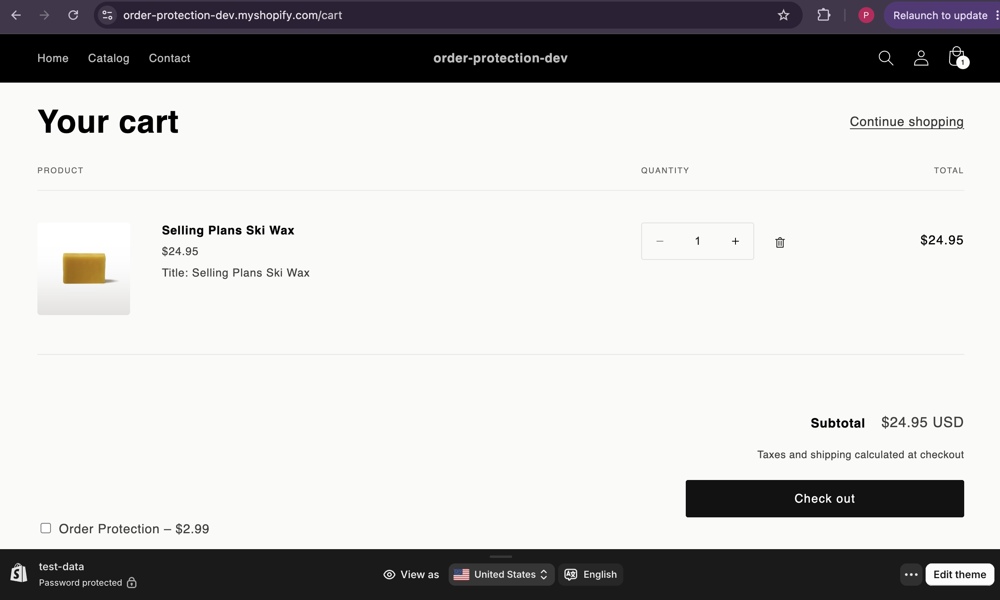
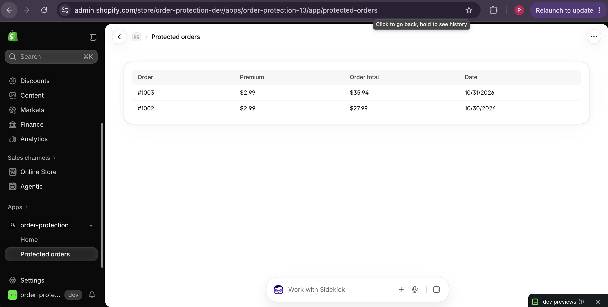

# Order Protection

A Shopify app that lets shoppers add shipping protection to their order from the cart. Once the order is placed, Shopify sends a webhook and the app records the protected order in Supabase. Merchants see every protected order, with its premium and order total, on a page inside Shopify Admin.

## Demo

| Cart toggle                                                    | Protected orders page                                                |
| -------------------------------------------------------------- | -------------------------------------------------------------------- |
|  |  |

## Architecture

```
Storefront cart
  └─ Theme app extension (extensions/cart-protection)
       checkbox → /cart/add.js | /cart/change.js  (variant SKU: ORDER-PROTECTION)
        │
        ▼
Shopify checkout → order created
        │  orders/create webhook (HMAC-signed)
        ▼
Supabase Edge Function (supabase/functions/shopify-orders-create)
  1. verify HMAC on raw body
  2. insert into webhook_events      (idempotency log)
  3. if order has ORDER-PROTECTION line → insert into protected_orders
        │
        ▼
Supabase Postgres (supabase/migrations)
        │  queried server-side with secret key, filtered by shop
        ▼
Admin page /app/protected-orders (React Router, Polaris web components)
```

Shopify sessions are stored separately by the template's Prisma/SQLite setup (`prisma/`).

## Key decisions

- **HMAC verified on the raw body, fail closed.** The function reads `req.text()` before parsing JSON, because re-serializing the JSON would change the bytes and break the signature. If `SHOPIFY_API_SECRET` is missing it returns 500 rather than skipping verification.
- **Idempotent webhook handling.** `webhook_events.webhook_id` is `unique`. On a duplicate (`23505`), the function does not stop: it carries on to the `protected_orders` insert. If an earlier delivery was logged but failed before the order was saved, Shopify's retry still records the order.
- **No duplicate orders.** `protected_orders` has `unique(shop_domain, shopify_order_id)`. A retry that hits this constraint returns 200 so Shopify stops retrying.
- **Tenant isolation.** RLS is enabled on every table and no public policies exist, so the anon key can read nothing. Only server code uses the secret key, and the admin loader always filters by the authenticated `session.shop`.
- **UTC in, shop time out.** Timestamps are stored as `timestamptz` (UTC). The admin page fetches the shop's `ianaTimezone` from the Admin API and formats dates with it, so the dates match Shopify Admin and there is no hydration mismatch between server and browser.

## Setup

Prerequisites: Node.js, Shopify CLI, Supabase CLI, a Shopify Partner app and a dev store.

```bash
npm install
npm run setup                          # Prisma session storage

supabase start                         # local stack (optional, for local dev)
supabase link --project-ref <project-ref>
supabase db push                       # apply migrations
supabase secrets set SHOPIFY_API_SECRET=<value>
supabase functions deploy shopify-orders-create --no-verify-jwt

shopify app dev
```

`--no-verify-jwt` is required because Shopify does not send a Supabase JWT; authenticity comes from the HMAC check instead (also set as `verify_jwt = false` in `supabase/config.toml`).

Update the `orders/create` webhook `uri` in `shopify.app.toml` to point to your own project's function URL.

In the dev store, create a product with handle `order-protection` and a variant with SKU `ORDER-PROTECTION`, publish it to the Online Store channel, then add the **Order Protection** app block to the cart template in the theme editor.

### Environment variables

App (`.env`):

- `SHOPIFY_API_KEY`
- `SHOPIFY_API_SECRET`
- `SHOPIFY_APP_URL`
- `SCOPES`
- `SUPABASE_URL`
- `SUPABASE_SECRET_KEY`

Edge Function (Supabase secrets):

- `SHOPIFY_API_SECRET`

## Known limitations

- **Flat premium.** The premium is the variant's fixed price ($2.99), not a percentage of the order total.
- **Full page reload.** The toggle reloads the page after changing the cart instead of updating the cart drawer via AJAX.
- **No automated tests yet.**

## Next steps

- **Claims flow.** The `claims` and `claim_events` tables already exist (status: open → approved/denied → paid, with an audit trail). Next is building the merchant UI and API for them.
- **Tests.** `deno test` for `verifyShopifyHmac` (valid, tampered body, wrong secret), plus webhook handler tests for the duplicate paths.
- **CI.** Lint, typecheck and tests on every PR; deploy the function from CI.
- **Dependency review.** Run `npm audit` and resolve the findings.
- **Constant-time HMAC comparison.** Replace `===` with a timing-safe comparison.
- **Mark processed events.** Set `webhook_events.processed_at` after a successful insert.
